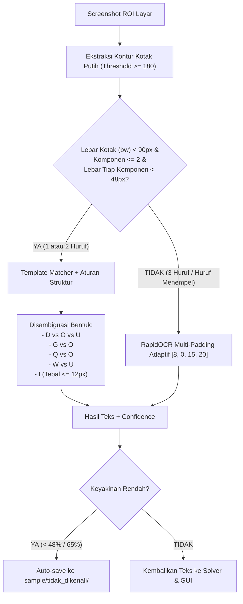

# 🤖 DOKUMENTASI PEMELIHARAAN PROJECT (AGENTS.md)
> **Untuk AI Coding Agent & Developer Masa Depan**  
> Dokumen ini adalah panduan komprehensif arsitektur, alur logika, aturan kritis, dan prosedur pengujian untuk memelihara dan mengembangkan proyek **Roblox Sambung Kata Assistant & Auto Solver**.

---

## 📌 1. Ringkasan Proyek & Target Game

- **Nama Project:** Roblox Sambung Kata Assistant & Auto Solver
- **Direktori Utama:** `C:\Users\Alden\Documents\VSCode\sambung-kata-overlay`
- **Target Game:** Roblox Sambung Kata (`https://www.roblox.com/games/130342654546662/Sambung-Kata`)
- **Mekanisme Game:**
  1. Game menampilkan kotak putih bersudut melengkung (*rounded rectangle*) dengan font hitam berukuran besar di tengah layar.
  2. Teks di dalam kotak tersebut adalah **AWALAN KATA (PREFIX)** berupa 1, 2, atau 3 huruf (contoh: `M`, `BU`, `EX`, `BUK`, `GOH`, dll.).
  3. Pemain harus mengetikkan kata bahasa Indonesia yang **berawalan** huruf tersebut sebelum waktu habis.
- **Strategi Utama Bot:**
  - 💥 **Menyerang (Offensive):** Memprioritaskan kata valid yang berakhiran huruf mematikan, terutama **X** (contoh: `SEX`, `COMPLEX`, `PARADOX`, `DETOX`), diikuti huruf sulit lainnya (**Z, Q, V, J, W, F**) agar lawan berikutnya terjebak atau kehabisan kata.
  - 🛡️ **Bertahan (Defensive):** Jika lawan menjebak dengan awalan sulit (seperti `X`, `IX`, `Q`, `EXO`), bot langsung menyediakan kata bertahan yang terdaftar di kamus resmi/Roblox.

---

## 🏗️ 2. Arsitektur File & Komponen

```
sambung-kata/
├── app_gui.py           # GUI Utama (Tkinter Dark Theme, Always-on-top, Hotkey F2)
├── main.py              # Entry point GUI (menjalankan app_gui.py)
├── main_cli.py          # Entry point Terminal / Headless mode
├── ocr_engine.py        # Core Vision & OCR: Dual-Engine (Template Matching + RapidOCR)
├── gameplay_indexer.py  # Pemantau Gameplay & Auto-Indexer (Deteksi kata salah/sudah dipakai/benar)
├── updater.py           # Git Updater Otomatis (Prompt, Auto-update, Disabled, Commit log parser)
├── solver.py            # Mesin pencari kata berawalan prefix dengan sistem tier prioritas
├── region_selector.py   # DPI-aware transparent overlay untuk seleksi ROI di monitor 1920x1200
├── config.py            # Utilitas load/save konfigurasi JSON
├── config.json          # Menyimpan area ROI layar, interval scan, dan preferensi pengguna (tracked base)
├── config.local.json    # Override konfigurasi lokal pengguna (untracked / gitignored, kebal git update)
├── blacklist.txt        # Daftar kata yang di-blacklist (kata valid KBBI namun ditolak oleh server Roblox)
├── kamus_lengkap.txt    # 147,870+ kata (Hasil Hybrid Merge: KBBI v6 + contek-sambungkata.web.id + istilah Roblox + jebakan X/Z)
├── kamus_kbbi.txt       # 112,822 kata murni Kamus Besar Bahasa Indonesia (KBBI VI)
├── kamus_contek.txt     # 108,123 kata dari basis data contek-sambungkata.web.id + jebakan Roblox
├── requirements.txt     # Dependensi Python
├── run.bat              # Batch script 1-klik untuk user Windows
├── test_accuracy.py     # Suite pengujian regresi otomatis (92 sampel benchmark)
├── test_gameplay_indexer.py # Suite pengujian status gameplay sequence (benar, kata tidak ada, sudah dipakai)
├── README.md            # Dokumentasi panduan untuk pengguna akhir
├── AGENTS.md            # Dokumen ini (panduan teknis untuk AI Agent)
├── sample/              # Direktori dataset sampel gambar nyata game
│   ├── 1/               # Sampel 1 huruf (A, F, G, I, K, L, M, N, O, P, Q, R, S, T, Y)
│   ├── 2/               # Sampel 2 huruf (AI, AL, AN, DA, EI, EX, IH, IK, JI, MI, NG, UH, UK)
│   ├── 3/               # Sampel 3 huruf (ANA, ANG, ARE, EXO, ING, KIR, NGI, NUM, ...)
│   ├── tidak_dikenali/  # Subfolder auto-save untuk deteksi berkeyakinan rendah (< 48%)
│   ├── tidak_dikenali_corrected/ # 11 sampel benchmark tantangan tinggi
│   └── kurang_tepat/    # Sampel salah deteksi yang disimpan manual oleh user (F2)
└── deteksi-gameplay/    # Dataset sequence gameplay untuk pengujian status kata
    ├── benar/           # Urutan frame kata diterima (kotak hilang + tubuh flash hijau)
    ├── default/         # Full screenshot saat mengetik di kotak putih
    ├── kata-tidak-ada/  # Urutan 16 frame kata ditolak Roblox (kotak merah tanpa subtext)
    └── sudah-dipakai/   # Urutan 16 frame kata sudah terpakai (kotak merah + subtext "sudah digunakan")
```

---

## 🧠 3. Logika & Strategi OCR Engine (`ocr_engine.py`)

Font Roblox Sambung Kata memiliki karakteristik khusus (garis tebal, spasi rapat, dan sering terjadi kemiripan glyph). Oleh karena itu digunakan **Dual-Engine Architecture**:



### A. Preprocessing Kotak Putih
- Roblox menampilkan kotak putih dengan intensitas grayscale $> 180$.
- `cv2.threshold(gray, 180, 255)` + `cv2.findContours` memotong persis kotak putih prompt, mengabaikan latar belakang arena Roblox.

### B. Jalur 1 & 2 Huruf: Template Matching + Disambiguasi Struktur
Digunakan untuk 1 atau 2 huruf karena WinOCR/Tesseract sering mengabaikan huruf tunggal:
1. **Huruf `I`**: Di font Roblox, `I` adalah garis vertikal tunggal tipis. Jika lebar komponen $\le 12\text{ px}$, **pasti `I`**.
2. **Huruf `B` vs `D` vs `E` vs `O` vs `U`**:
   - `B`, `D`, dan `E`: 4 kolom kiri memiliki tiang pekat lurus vertikal (`left_mean > 190`), bagian atas horizontal tertutup (`top_center > 120`), dan palang bawah horizontal tertutup (`bot_center > 100`). Palang bawah ini juga membedakannya dari `F` (`bot_center < 60`).
   - Pembeda `E`: Sisi kanan bawah terbuka horizontal (`r_low < 80`), berbeda dari `B` dan `D` yang melengkung tertutup rapat (`r_low > 140`).
   - Pembeda `B` vs `D`: `B` memiliki palang horizontal di tengah yang membagi dua lubang (`center_hole > 120`), sedangkan `D` adalah satu rongga besar berlubang di tengah (`center_hole < 60`).
   - `U`: Bagian atas tengahnya berongga/terbuka (`top_center < 80`).
3. **Huruf `G` vs `C` vs `O`**:
   - `G` dan `C` sama-sama terbuka di kuadran kanan atas (`ur_mean < 110`), sedangkan `O` tertutup.
   - Pembeda `G` vs `C`: `G` memiliki tiang/stem vertikal tebal di kuadran kanan bawah (`x > 70%`, `y: 45%-75%`, `r_stem > 90`). Sedangkan `C` sama sekali tidak memiliki tiang di sisi kanan (`r_stem < 60`).
4. **Huruf `Q` vs `O`**:
   - `Q`: Memiliki ekor diagonal di sudut kanan bawah (`tail.mean() > 115` atau tinggi $\ge 41\text{ px}$).
5. **Huruf `W` vs `U`**:
   - `W`: Memiliki dua lembah dan lebar fisik $\ge 32\text{ px}$.
   - `U`: Hanya satu lembah dengan lebar fisik $\le 27\text{ px}$.

### C. Jalur 3 Huruf: Template Matching Komponen Terpisah + Fallback RapidOCR
1. **Komponen Terpisah (3 Huruf Bersih)**:
   - Jika `len(comps) == 3` dan lebar masing-masing komponen $< 44\text{ px}$ (seperti `HOI`, `ANA`, `GOH`), template matching dijalankan terlebih dahulu. Jika rata-rata confidence $\ge 0.75$, hasil template matching langsung digunakan (menghindari kesalahan urutan pembacaan seperti `HOI` terbaca `1OH`).
2. **Huruf Menempel / Ambigu (Contoh: `KAR`, `AKAN`)**:  
   Pada kata seperti `KAR` atau `AKAN`, kaki huruf dapat saling bersentuhan tipis sehingga `connectedComponents` menggabungkan keduanya menjadi satu komponen lebar ($48 \le cw \le 68\text{ px}$).  
   *Slicing Vertikal Cerdas:* Sistem memotong komponen tersebut pada lembah piksel terendah (*vertical projection dip*) di area tengah (30%–70% lebar komponen). Potongan yang dihasilkan langsung dicocokkan via Template Matcher dalam **1–2 ms** (menghemat ~480 ms dibanding deep learning).
3. **Multi-Padding Adaptif (`[8, 0, 15, 20]`) dengan Early Exit:**  
   Detektor DBNet pada RapidOCR sangat sensitif terhadap padding kotak:
   - `pad = 8`: Padding ideal untuk kata normal (`GOH`, `GAL`, `HAI`). Mencegah huruf pertama terpotong.
   - `pad = 0`: Direct unpadded crop. Sangat penting untuk kata seperti `OXO` di mana penambahan border luar justru mengacaukan deteksi.
   - `pad = 15`: Margin menengah.
   - `pad = 20`: Margin lebar untuk kata yang sangat padat/ringkas seperti `DIH` (lebar 95px).
   - *Early Exit:* Jika pada `pad = 8` deteksi telah menghasilkan kata 3 huruf dengan keyakinan $\ge 0.50$ atau kata panjang ($\ge 2$ huruf) dengan keyakinan $\ge 0.70$, sistem langsung mengembalikan hasil seketika tanpa perlu mengeksekusi pad berikutnya (memangkas waktu dari 3.4 detik menjadi 0.5 detik).

### D. Kalibrasi Ambang Batas Keyakinan (*Confidence Level*)
- **Template Matcher (1–2 huruf):** Skor rata-rata 0.70 – 0.98. Jika skor $< 0.65$, tandai `is_low_confidence = True`.
- **RapidOCR (3 huruf):** Rata-rata skor pengenalan kata adalah 0.50 – 0.75. Jangan gunakan ambang 0.65 (akan menimbulkan false positive warning pada kata benar seperti `AMA`, `ASA`, `HAI`). Ambang batas yang tepat adalah **`< 0.48`**.

---

## 🎯 4. Mekanisme Kalibrasi Manual (`sample/kurang_tepat`)

Ketika pengguna sedang bermain atau melakukan *spectate*, terkadang OCR membaca teks yang salah namun memiliki nilai *confidence* yang tinggi (sehingga tidak masuk ke `sample/tidak_dikenali`).

- **Tombol UI & Hotkey:** Tombol `🚩 Deteksi Salah (F2)` dan shortcut keyboard `F2`.
- **Alur Kerja:**
  1. Tombol atau tombol `F2` ditekan: screenshot area langsung diambil dan disimpan seketika (< 5ms) ke folder `sample/kurang_tepat/` tanpa popup dialog (non-blocking).
  2. Notifikasi toast halus muncul di bagian bawah layar.
  3. Format nama file: `YYYYMMDD_HHMMSS_<TERDETEKSI>_<conf>pct.png`.
  4. Pengguna dapat melanjutkan bermain tanpa kehilangan fokus keyboard atau waktu giliran game.
  5. **Jendela Pendataan Koreksi (`📝 Koreksi (N)`):** Setelah selesai bermain, pengguna mengklik tombol `📝 Koreksi` untuk membuka antarmuka visual pendataan. Mendukung dua sumber sampel:
     - `🚩 Kurang Tepat` (hasil tangkapan manual F2 di `sample/kurang_tepat/`)
     - `⚠️ Tidak Dikenali` (hasil auto-save keyakinan rendah di `sample/tidak_dikenali/`)
     Gambar ditampilkan diperbesar, pengguna mengetik awalan yang benar lalu menekan `Enter`. File otomatis di-*rename* menjadi `YYYYMMDD_HHMMSS_<TERDETEKSI>_seharusnya_<BENAR>_<conf>pct.png` dan berpindah ke sampel berikutnya secara berurutan.
     - **Shortcut `Del` (Tanpa Konfirmasi):** Pengguna dapat menekan tombol `Del` (Delete) di keyboard atau mengklik `🗑️ Hapus Sampel (Del)` untuk menghapus file sampel seketika tanpa popup konfirmasi, mempercepat pembersihan sampel sampah/blank.

---

## ⚡ 5. Logika Solver & Kamus (`solver.py`)

1. **Struktur Prioritas Kata & Mode Sortir Tier 0**:
   - **Mode Standar / Normal / Brutal**:
     - **Tier 0 (🔥 CUSTOM TRAPS):** Kata berakhiran kustom (misal `NS`, `NGK`, `MP`). Mendukung 2 mode pengurutan:
       - **Mode Default (`default`):** Panjang ideal (4–7 huruf pertama, 3 huruf, 8 huruf, >8 huruf) dipadukan dengan *stable sort* urutan abjad kamus (A–Z) lintas tag. Menghasilkan kata yang paling cepat dan nyaman diketik.
       - **Mode Urutan Tag (`tag_order`):** Mengelompokkan kata secara ketat berdasarkan urutan tag di daftar kustom pengguna (tag teratas muncul lebih dulu seluruhnya sebelum tag berikutnya, misal semua kata `NS` sebelum `MP`). Berguna ketika pemain ingin memprioritaskan jebakan tersulit.
       - **Tombol Cepat di UI Utama (`📊 DEFAULT` / `🏷️ URUT TAG`):** Pemain dapat berpindah mode sortir seketika dalam 1-klik langsung dari header toolbar tanpa harus membuka menu Settings atau jendela Kelola Tag.
     - **Tier 1 (💥 JEBAKAN X):** Kata yang berakhiran `X` (contoh: `SEX`, `COMPLEX`, `PARADOX`, `DETOX`, `BOX`, `FAX`, `BODREX`).
     - **Tier 2 (⚡ JEBAKAN SULIT):** Kata yang berakhiran konsonan sulit: `Z`, `Q`, `V`, `J`, `W`, `F`.
     - **Tier 3 (🛡️ NORMAL):** Kata standar KBBI, diurutkan dari yang terpendek agar cepat diketik.
   - **Manajemen Tag Kustom (Edit, Sortir & Auto-Reflow Layout):**
     - Tag kustom dapat diubah urutannya via tombol panah `▲`/`▼` atau diurutkan otomatis (`🔤 A-Z`, `📊 Terbanyak`, `📏 Terpanjang`, `📏 Tersedikit` [paling sedikit huruf]).
     - Setiap tag dapat diedit huruf akhiran, label nama, serta warna badge (Catppuccin swatches / Color Picker).
     - **Baris Quick Toggle Tag di UI Utama (`custom_cats_bar`):**
       - Deretan tombol tag cepat tepat di atas kartu rekomendasi kata mendukung pembungkusan baris dinamis (*dynamic multi-row auto-wrap*).
       - Perhitungan lebar fisik tombol dihitung secara presisi menggunakan `tkfont.Font.measure(sfx)` ditambah padding internal dan margin Windows (`btn_w = tag_font.measure(sfx) + 20`) dengan *safety margin* 14px.
       - Dilengkapi event listener `<Configure>` dengan debouncing 30ms sehingga setiap kali jendela UI di-resize atau diperkecil, barisan tag otomatis melakukan reflow secara real-time dan tag di ujung (seperti `EI`, `GY`, `TY`) tidak akan pernah terpotong atau keluar dari layar (*never off-screen*).
   - **Mode Development & Tombol Restart (`config.local.json`):**
     - Tombol `⚡ Restart` di header disembunyikan secara default (`dev_mode: false`).
     - Pengguna/developer dapat mengaktifkannya via `⚙️ Settings ➔ 🛠️ Mode Development` atau shortcut `Ctrl+Shift+D`.
     - Pengaturan `dev_mode` disimpan ke `config.local.json` (terdaftar di `.gitignore`).
     - **Kebal Pembaruan Git:** Karena `config.local.json` tidak dilacak oleh Git, saat pengguna melakukan `git pull` atau auto-update repository, mode development dan status tombol restart tetap aktif tanpa ter-reset ke default GitHub.
   - **🎮 Tiga Mode Permainan (DEFAULT, SANTAI, BRUTAL):**
     - **1-Klik Cycle & Menu Klik-Kanan:** Tombol mode di toolbar atas dapat diklik kiri untuk beralih berurutan (`DEFAULT` ➔ `SANTAI` ➔ `BRUTAL` ➔ `DEFAULT`) atau diklik kanan untuk membuka dropdown menu pemilihan langsung beserta shortcut pengaturan.
     - **⚔️ Mode Default (`game_mode="default"`):** Mode standar menyerang dengan jebakan X, konsonan sulit, dan tag kustom aktif pengguna.
     - **🌿 Mode Santai (`game_mode="santai"`):**
       - Dikhususkan untuk room Roblox Mode Santai yang melarang huruf `X`, `Q`, dan `F`.
       - Seluruh kata yang berakhiran `X, Q, F` atau mengandung huruf `X` / `Q` disaring ketat dan dibuang.
       - Tag kustom yang mengandung `X, Q, F` otomatis dimatikan dan dipulihkan saat kembali ke Mode Default.
     - **🔥 Mode Brutal (`game_mode="brutal"`):**
       - Dikhususkan untuk room kompetitif/brutal Roblox dengan akhiran mematikan seperti `AMSI` (akamsi, syamsi), `KSO` (bakso, dakso, ekso), `RHU` (borhu, erhu), `TL` (axolotl, ritl), `BD` (apbd, ibd), dll.
        - **Jendela Pengaturan Mode Brutal (`🔥 Pengaturan Mode Brutal`):**
          - Pengguna dapat memilih tag kustom mana saja yang otomatis dinyalakan saat Mode Brutal aktif via checklist, tombol cepat `⚡ Pilih Semua`, `🔄 Reset Default (AMSI, KSO, RHU, TL, BD)`, `❌ Hapus Semua`, serta form pendaftaran akhiran baru.
          - **Interaksi Se-baris (Click Anywhere):** Mengklik di bagian mana saja pada satu baris (frame baris, badge akhiran, nama tag, jumlah kata, maupun pill status) langsung me-toggle status tag seketika tanpa harus menekan kotak centang kecil secara presisi.
          - **Visual Kontras Tinggi:**
            - **Aktif (BRUTAL):** Latar belakang baris berubah menjadi merah marun pekat (`#381d28`) dengan bingkai highlight merah (`#f38ba8`), teks nama putih tebal (`#f5e0dc`), checkmark merah terang, dan pill status kanan berubah menyala menjadi `🔥 BRUTAL` (latar merah terang `#f38ba8`, font hitam pekat `#11111b`).
            - **Nonaktif:** Latar belakang abu-abu gelap standar (`#1e1e2e`) dengan bingkai halus (`#313244`), teks redup (`#6c7086`), dan pill status kanan berwarna abu-abu redup `⚪ NONAKTIF`.
          - **Perbaikan Scroll Mousewheel Mulus:** Mousewheel terikat secara menyeluruh (`_bind_scroll_recursive` dan routing terisolasi `self.brutal_canvas`) ke seluruh kontainer, canvas, frame inner, scrollbar, dan setiap widget baris, sehingga scrolling roda mouse selalu bekerja mulus tanpa dead spot.
       - **Isolasi Profil Tag Cerdas:** Tag aktif di Mode Default disimpan ke `saved_default_tags` (dan `saved_normal_tags`). Saat beralih ke Mode Brutal, tag disetel sesuai daftar `brutal_mode_tags`. Men-toggle tag pada quick-bar saat di Mode Brutal otomatis menyinkronkan daftar Brutal, dan saat kembali ke Mode Default, daftar tag default pengguna dipulihkan secara utuh tanpa tercampur.
2. **Validasi Vokal**:
   - Setiap kata wajib memiliki minimal 1 huruf vokal (`A, I, U, E, O`) untuk menyaring singkatan atau akronim aneh yang tidak diterima oleh kamus game Roblox.
3. **Kamus Lengkap (`kamus_lengkap.txt`)**:
   - Berisi **147,870+ kata** hasil penggabungan cerdas (*Hybrid Merge*):
     - Seluruh database 108,344 kata dari `contek-sambungkata.web.id` (mencakup kata gaul Roblox seperti `aho`, `alo`, `wibu`, dan kata berimbuhan `dipandang`, `terbaiknya`, dll.).
     - Seluruh kosakata baku KBBI VI dan istilah ilmiah/serapan.
     - Kosakata serapan/game yang terbukti valid di Roblox (seperti `sex`, `roblox`, `noob`, `pro`).
     - Pembersihan kata bahasa Inggris non-Indonesia murni yang ditolak game (contoh: `climax` dibersihkan karena Roblox memakai `klimaks`).
4. **Sistem Blacklist Kata (`blacklist.txt`)**:
   - Menyimpan daftar kata yang tidak boleh direkomendasikan bot karena ditolak atau disensor oleh Roblox (misal: `hoax`).
   - Disimpan dalam file teks datar `blacklist.txt` (satu kata per baris, case-insensitive).
   - Di-*load* ke dalam memori sebagai `set` Python untuk filtering instan $O(1)$ di `solver.py`.
   - Dapat ditambah langsung dari GUI via tombol `❌` di setiap kartu kata dan dapat dibatalkan via tombol `↩️ Batalkan` (Undo).
   - Jendela **`🚫 Blocklist`** di GUI memungkinkan pemain melihat semua kata terblokir, mencari kata tertentu, menghapus kata dari blocklist, menambah kata secara manual, serta membuka file `blacklist.txt` di Notepad.
   - Saat dibuka, fokus kursor otomatis berada di kolom input kata. Menekan `Enter` seketika memblokir kata tersebut dan menutup popup (*Enter-to-close*).
   - Menjaga integritas file utama `kamus_lengkap.txt` tanpa menghapus data aslinya.
5. **Sistem Whitelist Kata (`whitelist.txt`)**:
   - Menyimpan daftar kata yang **terbukti 100% valid dan dapat diterima** oleh server game Roblox.
   - Disimpan dalam file teks datar `whitelist.txt` (satu kata per baris, case-insensitive).
   - **Prinsip Isolasi Kamus:** Kata yang di-whitelist **TIDAK DITULIS** ke file kamus (`kamus_lengkap.txt`, `kamus_contek.txt`, `kamus_kbbi.txt`), melainkan hanya hidup di `whitelist.txt`.
   - **Prioritas Teratas di Kategorinya:** Di dalam fungsi pencarian solver (`cari_jawaban`), kata yang terdaftar di whitelist otomatis diposisikan di urutan **paling atas** di dalam tier/kategorinya masing-masing (`is_whitelisted = 0` mendahului kata non-whitelist `1`):
     - Di kategori `💥 JEBAKAN X`: kata whitelist berakhiran X berada di posisi #1 sebelum kata non-whitelist berakhiran X.
     - Di kategori `🏷️ Kategori Kustom (Tier 0)`: kata whitelist kustom berada di puncak.
     - Di kategori `⚡ JEBAKAN SULIT` & `🛡️ NORMAL`: selalu menempati urutan teratas.
   - **Sinkronisasi Otomatis:** Menambahkan kata ke whitelist seketika membuang kata tersebut dari `blacklist.txt` jika sebelumnya terblokir.
   - Tersedia tombol bintang (`☆`/`⭐`) langsung di setiap kartu rekomendasi GUI dan jendela manajemen whitelist tersendiri via `⚙️ Settings ➔ ⭐ Buka Whitelist Kata`.
6. **Penambahan Kata Manual (`add_word`)**:
   - Pemain dapat menambahkan kata baru via tombol `➕ Kamus` di GUI.
   - Saat dibuka, fokus kursor otomatis berada di kolom input kata. Menekan `Enter` seketika memvalidasi, menyimpan ke kamus, dan menutup popup (*Enter-to-close*).
   - Kata divalidasi (alfabet murni, min 2 huruf, wajib punya vokal `AIUEO`).
   - Disimpan secara persisten ke `kamus_lengkap.txt` dan diindeks langsung ke memori solver ($O(1)$) tanpa perlu restart aplikasi.
   - Jika kata sebelumnya berada di `blacklist.txt`, status blacklist otomatis dibatalkan/dipulihkan.
7. **UI Penjelajah & Eksplorasi Kamus Lengkap (`search_dictionary`)**:
   - Memungkinkan pemain menelusuri seluruh basis data kosakata (147,000+ kata) secara instan dengan integrasi penuh manajemen Whitelist & Blocklist.
   - **Tiga Mode Pencarian Fleksibel:**
     - **Awalan (Prefix):** Menyaring kata yang berawalan teks tertentu (dioptimasi via indeks huruf awal $O(1)$).
     - **Akhiran (Suffix):** Menyaring kata yang berakhiran teks tertentu.
     - **Mengandung (Contains):** Menemukan kata yang memuat teks tertentu di posisi mana pun.
   - **Filter Sumber Kosakata:**
     - Pemain dapat memfilter sumber kosakata: **`🌐 Semua`**, **`📚 KBBI Saja`**, **`🎮 Contek Saja`**, atau **`✨ KBBI + Contek (Irisan keduanya)`**.
   - **Filter Multi-Tag & Status Tanpa Brackets:**
     - Label tag ditampilkan bersih tanpa kurung siku (`NS`, `💥 X`, `⚡ Z`, `Normal`, dll.).
     - Teks baris diwarnai dengan palet Catppuccin yang selaras dengan kartu rekomendasi UI utama (merah untuk X & Blocklist, peach untuk konsonan sulit, kuning untuk Whitelist, mauve/kustom untuk tag custom endings).
   - **Kolom Tabel Lengkap & Sortir Semua Kolom:**
     - Kolom tabel: `#`, `Kata`, `Panjang` (teks utuh, bukan singkatan), `Tag / Akhiran`, dan `Sumber`.
     - Seluruh kolom dapat disortir secara ascending/descending (`▲` / `▼`) hanya dengan mengklik header kolom.
   - **Infinite Scroll & Autoload Tanpa Batas:**
     - Sistem me-render batch 500 baris pertama (< 2 ms) tanpa freeze, lalu otomatis memuat batch berikutnya saat di-scroll ke bawah tanpa batasan 1.000 entri.
     - Tersedia tombol cepat **`⚡ Muat Semua`** jika pengguna ingin langsung me-render seluruh ratusan ribu baris sekaligus.
   - **Integrasi Penuh Manajemen Whitelist & Blocklist:**
     - Chip counter real-time: `⭐ WHITELIST (N)` dan `🚫 BLOCKLIST (N)` di panel tag.
     - Tombol aksi 1-klik di footer: `⭐ Whitelist` dan `🚫 Blocklist` (otomatis toggle tambah/hapus pada seleksi atau teks input cari).
     - Tombol cepat untuk membuka file teks langsung: `📂 whitelist.txt` dan `📂 blacklist.txt`.
     - Context menu klik kanan dinamis yang menyesuaikan status kata (Hapus/Tambah Whitelist, Pulihkan/Blokir Blocklist).
8. **Pemilihan Sumber Kamus (KBBI vs Contek Sambung Kata)**:
   - Pemain dapat memilih sumber kamus yang digunakan melalui checkbox di GUI:
     - **`KBBI` (`kamus_kbbi.txt`):** 112,822 kosakata baku bahasa Indonesia murni.
     - **`Contek Sambung Kata` (`kamus_contek.txt`):** 108,123 kosakata dari basis data `contek-sambungkata.web.id` + jebakan kata Roblox.
   - Mendukung pemilihan salah satu kamus atau penggabungan keduanya (147,886 kata unik).
   - Pengaturan tersimpan otomatis di `config.json` (`use_kbbi`, `use_contek`) dan peralihan kata terjadi seketika di memori solver (< 15 ms).
   - Validasi keamanan: Sistem secara otomatis mencegah kedua checkbox dinonaktifkan bersamaan (minimal satu sumber harus aktif).

---

## 🎮 5b. Sistem Pengindeks & Pemantau Gameplay Otomatis (`gameplay_indexer.py`)

Aplikasi dilengkapi modul pemantau visual gameplay otomatis untuk mengenali dan mengindeks kata berdasarkan respon nyata server Roblox Sambung Kata:

1. **Tiga Ciri Visual Status Kata:**
   - **`KATA_SALAH` (Kata Ditolak / Tidak Terdaftar di Roblox):**
     - Kotak teks input berubah menjadi latar **merah pekat** ($R > 100, R > G \times 1.3$).
     - Indikator 'X' merah (nyawa) berubah dari redup menjadi 100% merah.
     - **TIDAK ADA** subtext `"sudah digunakan!"` di bawah kotak teks.
     - *Aksi Otomatis (Terisolasi):* Kata dicatat ke file staging terpisah `auto_blacklist.txt` (TIDAK menyentuh atau mencemari `blacklist.txt` resmi), dan notifikasi toast muncul.
   - **`SUDAH_DIGUNAKAN` (Kata Valid tapi Sudah Terpakai Ronde Ini):**
     - Kotak teks input berubah menjadi latar **merah pekat**.
     - Tepat di bawah kotak merah muncul subtext tulisan putih ber-outline hitam: `'"<KATA>" sudah digunakan!'` (terbaca via OCR).
     - *Aksi Otomatis (Terisolasi):* Kata ini terbukti **VALID** di server Roblox. Jika belum terdaftar di kamus resmi, sistem mencatatnya ke `auto_kata_baru.txt` (TIDAK menyentuh kamus utama).
   - **`KATA_BENAR` (Jawaban Berhasil & Diterima):**
     - Kotak kata teks di atas pemain **LENYAP SEKETIKA**.
     - Tubuh karakter pemain di bawahnya seketika **FLASH HIJAU TERANG** (HSV Green Pixels > 10,000, melonjak masif dari rata-rata ~1,100 px).
     - *Aksi Otomatis (Terisolasi):* Kata jawaban dicatat ke `auto_kata_baru.txt` jika belum ada di kamus resmi.
2. **Isolasi Data Kamus & Human-in-the-Loop:**
   - Kamus resmi (`kamus_kbbi.txt`, `kamus_contek.txt`, `kamus_lengkap.txt`) dan `blacklist.txt` **100% aman dan tidak tersentuh** oleh deteksi otomatis.
   - Semua hasil auto-detect masuk ke file staging terpisah (`auto_blacklist.txt` dan `auto_kata_baru.txt`) untuk dikurasi atau diverifikasi pengguna.
3. **Kinerja & Dual-Engine OCR:**
   - Memanfaatkan **WinOCR** sebagai engine utama untuk pemrosesan ROI kotak gameplay ($440 \times 400\text{ px}$), selesai dalam **4–17 ms** tanpa membebani performa frame rate game.
   - Fallback otomatis ke RapidOCR jika dijalankan di lingkungan tanpa WinOCR.
4. **Mekanisme Debounce Anti-Duplikasi:**
   - Menghindari pemrosesan berulang pada animasi frame transisi (300 ms) dengan jeda cooldown 2.5 detik per kata.
5. **Alat Kalibrasi Mandiri (Hotkey F3 & Log GUI):**
   - **Hotkey `F3` (Snapshot Kalibrasi):** Mengambil screenshot snapshot area gameplay seketika dan menyimpan gambar PNG beserta metadata JSON (warna RGB, HSV, piksel merah, piksel hijau, OCR raw lines) ke folder `deteksi-gameplay/sample_kalibrasi/`.
   - **Tombol `🎮 Auto-Index Game`:** Mengaktifkan/menonaktifkan pemantauan otomatis.
   - **Tombol `🎯 Area Game`:** Membuka `RegionSelector` untuk memilih area kotak kata & karakter pemain secara visual.
   - **Tombol `📋 Log`:** Membuka dialog riwayat sesi dengan tombol langsung untuk membuka file `auto_blacklist.txt`, `auto_kata_baru.txt`, dan folder `sample_kalibrasi`.

---

## 🔄 6. Sistem Pembaruan Otomatis Git (`updater.py`)

Aplikasi dilengkapi modul `GitUpdater` (`updater.py`) untuk menjaga repository lokal tetap sinkron dengan GitHub:

1. **Dukungan Multi-Branch (`updater_branch` di `config.json`):**
   - Mengambil daftar seluruh remote branch secara dinamis via `git ls-remote --heads origin` (`get_available_branches()`).
   - Pengguna dapat memilih branch pembaruan (misal: `main` untuk versi stabil atau `dev` untuk update fitur terbaru) langsung dari dropdown GUI.
   - Mendeteksi perpindahan branch (`is_branch_switch = True`). Jika branch target berbeda dengan branch lokal saat ini, tombol update akan menampilkan `🔀 Beralih ke '<branch>' & Update` dan melakukan `git checkout <branch>` secara otomatis sebelum menarik commit terbaru.
2. **Pengecekan Komparatif HEAD vs `origin/<branch>`:**
   - Menjalankan `git fetch origin <branch>` secara non-blocking di background thread.
   - Mengambil jumlah commit tertinggal via `git rev-list --count HEAD..origin/<branch>`.
   - Mengurai riwayat perubahan via `git log HEAD..origin/<branch> --pretty=format:"%h%x09%an%x09%ad%x09%s"`.
   - Mengembalikan daftar terstruktur commit (hash, author, date, message) dan mendeteksi apakah `requirements.txt` ikut berubah.
3. **Tiga Mode Pembaruan (`updater_mode` di `config.json`):**
   - **`prompt` (Default):** Jika update ditemukan saat startup, dialog modal responsif terbuka menampilkan daftar commit perubahan lengkap dengan tombol `🚀 Perbarui Sekarang` dan opsi mode.
   - **`auto`:** Update diunduh dan diterapkan seketika di latar belakang saat startup tanpa bertanya, lalu notifikasi tombol *Restart* muncul.
   - **`disabled`:** Pengecekan otomatis saat startup dilewati sepenuhnya. Pemeriksaan manual tetap dapat dilakukan kapan saja via tombol `🔄 Update` di header.
4. **Eksekusi Update & Clean Restart:**
   - Menggunakan `git pull --autostash origin <branch>` agar modifikasi konfigurasi/kamus lokal tidak memicu konflik stash.
   - Jika `requirements.txt` diperbarui, perintah `pip install -r requirements.txt --quiet` dijalankan otomatis.
   - Fungsi `_restart_app_cleanly()` melepas semua global keyboard hook, mematikan thread OCR, lalu meluncurkan proses Python baru sebelum keluar.

---

## 🎨 6b. Standar Desain UI Frameless & Window Title Konsisten (`_create_clean_toplevel`)

Seluruh jendela sekunder / dialog popup di dalam aplikasi mengimplementasikan metode pembantu `_create_clean_toplevel()` pada `SambungKataApp` untuk mempertahankan estetika gelap Catppuccin yang bersih, modern, dan konsisten dengan antarmuka overlay utama:

1. **Custom Frameless Titlebar (`overrideredirect(True)`):**
   - Menggantikan title bar putih default Windows yang kaku dengan header gelap Catppuccin `#11111b` (tinggi 30px) berborder luar 1px `#313244`.
   - Menampilkan label judul di sisi kiri (`Segoe UI`, ukuran 8/9 Bold, warna `#cdd6f4`).
   - Tombol close interaktif `✕` di sudut kanan atas dengan transisi efek hover merah muda (`#f38ba8`).
2. **Interaktivitas & Kenyamanan Pengguna:**
   - **Drag-to-move:** Title bar dan label judul dapat diseret dengan mouse (`<ButtonPress-1>` & `<B1-Motion>`) untuk memindahkan posisi window secara mulus.
   - **Escape-to-Close:** Tombol keyboard `<Escape>` otomatis terikat untuk menutup jendela sekunder seketika.
   - **Resize Grip (`⋰` & `left_grip`):** Pada jendela resizable dan overlay utama, penyesuaian ukuran jendela dapat dilakukan dari tepi kiri (`left_grip`) maupun sudut kanan bawah (`grip_bar`).
   - **Smooth 60fps Window Resizing & Anti-Ghost Drag:**
     - Menggunakan sistem throttling 16ms (~60fps) pada `<B1-Motion>` untuk mencegah penumpukan event backlog di antrean pesan Windows/Tkinter.
     - Terikat listener `<ButtonRelease-1>` pada grip dan root window yang seketika menonaktifkan state `_is_resizing = False` dan membersihkan timer pending. Saat mouse dilepas, window seketika berhenti dan tidak akan pernah terus mengekor/mengikuti gerakan mouse (*never resizes after release*).
     - Menghentikan kalkulasi layout berulang selama mouse drag (canvas `scrollregion bbox` dan auto-reflow tag kustom di-pause selama drag aktif dan dieksekusi bersih satu kali saat drag selesai).
   - **High-Performance Dirty-Checking Card Pool (Ultra-Smooth Rendering):**
     - Kartu rekomendasi kata (limit 50 kata terbaik lintas tier) menerapkan caching properti visual (`kata`, `bg`, `badge_text`, `is_wl`, `packed`).
     - Tcl/Tk bridge `.config()` hanya dipanggil saat atribut benar-benar berubah, dan `.pack()` hanya dieksekusi saat kartu belum terpasang (menghemat ratusan pemanggilan layout per detik).
     - Menghapus 800+ binding `<Enter>`/`<Leave>` per kartu kata dan memusatkan scroll roda mouse (`<MouseWheel>`) langsung pada root window, melenyapkan glitch dan freeze saat kursor bergerak melintasi kartu.
     - Canvas otomatis di-reset ke scroll posisi teratas (`yview_moveto(0)`) setiap kali awalan kata berganti.
   - **Penempatan Cerdas (Adjacent Placement):** Jendela popup otomatis ditempatkan berdampingan di sebelah kiri jendela utama overlay agar tidak saling tumpang tindih atau menghalangi area game Roblox.
3. **Daftar 10 Jendela Sekunder yang Terstandarisasi:**
   - `gameplay_history_win` (Riwayat Auto-Index Gameplay)
   - `classifier_win` (Klasifikasi Momen Gameplay)
   - `blacklist_win` (Kelola Blocklist Kata)
   - `whitelist_win` (Kelola Whitelist Kata)
   - `custom_cats_win` (Kategori & Akhiran Kustom)
   - `edit_win` (Edit Tag Akhiran Kustom)
   - `koreksi_win` (Pendataan Koreksi Sampel)
   - `add_word_win` (Tambah Kata ke Kamus)
   - `update_win` (Pembaruan & Info Updater)
   - `dict_win` (Eksplorasi & Pencarian Kamus)

---

## 🌿 7. Strategi Branching & CI Workflow

Untuk menghemat kuota komputasi GitHub Actions dan mempercepat siklus development:
1. **Branch `dev` (Active Development):**
   - Seluruh coding aktif, eksperimen OCR, optimasi latensi turbo, dan penambahan fitur dilakukan di branch `dev`.
   - Push ke branch `dev` **tidak memicu GitHub Actions** (bebas commit kapan saja tanpa menghabiskan kuota).
2. **Branch `main` (Production & Release):**
   - Hanya menerima kode stabil hasil merge.
   - Setiap kali terjadi push atau merge ke `main`, GitHub Actions (`test.yml`) otomatis menjalankan rangkaian pengujian lengkap: OCR Benchmark (92 sampel), Solver & Custom Traps Unit Tests, dan Gameplay Indexer Sequence Tests di runner Windows.

---

## 🧪 8. Prosedur Pengujian Regresi Wajib

Setiap kali Anda (AI Agent) mengubah kode di `ocr_engine.py`, `solver.py`, `gameplay_indexer.py`, atau pipeline UI/image processing, **ANDA WAJIB MENJALANKAN SUITE PENGUJIAN REGRESI**:

```powershell
# 1. Benchmark Akurasi OCR Layar (Wajib 92/92 Lolos 100%)
python test_accuracy.py

# 2. Unit Test Solver, Custom Traps, Mode Santai, & Blacklist
python test_solver.py

# 3. Pengujian Sekuens Respon Visual Gameplay (Benar, Ditolak, Terpakai)
python test_gameplay_indexer.py
```

### Standar Kelulusan:
- Total dataset uji OCR: **92 sampel gambar nyata Roblox**
- **Wajib 100% Pass** tanpa ada penurunan akurasi atau peringatan keyakinan rendah (*false low confidence*).
- Seluruh 7 pengujian solver dan 5 pengujian gameplay indexer wajib berstatus **OK**.

---

## ⚠️ 9. Jebakan Kritis Lingkungan Windows (Gotchas)

1. **Penskalaan DPI Windows (1920x1200 / Scaling > 100%)**:
   - Jika `ctypes.windll.shcore.SetProcessDpiAwareness(2)` tidak dipanggil sebelum membuat Tkinter window, koordinat `mss.grab` dan koordinat overlay Tkinter akan meleset hingga 25-50%, menyebabkan area kotak seleksi terpotong.
2. **Encoding Konsol Windows (cp1252 vs UTF-8)**:
   - Terminal Windows PowerShell default menggunakan encoding `cp1252`. Jangan melakukan `print()` karakter emoji tingkat tinggi di skrip CLI tanpa membungkus `sys.stdout.reconfigure(encoding='utf-8')`, atau program akan crash dengan `UnicodeEncodeError`.
3. **Sintaks PowerShell String Quoting**:
   - Saat menjalankan perintah python inline dari PowerShell via sub-process/CLI, hindari kutip ganda bersarang (`python -c "print(\"...\")"` sering pecah). Selalu buat skrip Python sementara atau gunakan file skrip terdedikasi.
4. **Pustaka WinOCR**:
   - WinOCR memanfaatkan engine Windows Media OCR bawaan. Sangat bagus untuk kalimat panjang, namun kamus internal Windows Media OCR secara sengaja memblokir pengenalan 1 huruf latin (menganggapnya sebagai noise). Jangan gunakan WinOCR untuk 1 huruf.

---

## 📋 10. Panduan Menangani Sampel Baru dari User

Jika pengguna melaporkan gambar di `sample/kurang_tepat/` atau `sample/tidak_dikenali/`:
1. Buka dan periksa gambar menggunakan skrip inspeksi OpenCV.
2. Identifikasi apakah kegagalan terjadi di:
   - **Bounding box detection:** Apakah threshold 180 menangkap kotak dengan pas?
   - **Connected components:** Apakah huruf menempel seperti `KAR`?
   - **Padding:** Cek apakah pengujian pada `pad = [8, 0, 15, 20]` menghasilkan teks yang benar.
   - **Aturan bentuk:** Apakah perlu aturan baru untuk membedakan huruf tertentu?
3. Terapkan perbaikan di `ocr_engine.py`.
4. Jalankan `python test_accuracy.py` untuk memastikan seluruh 88+ sampel lama tetap lulus 100%.
