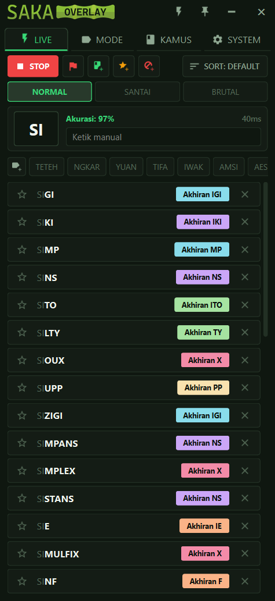
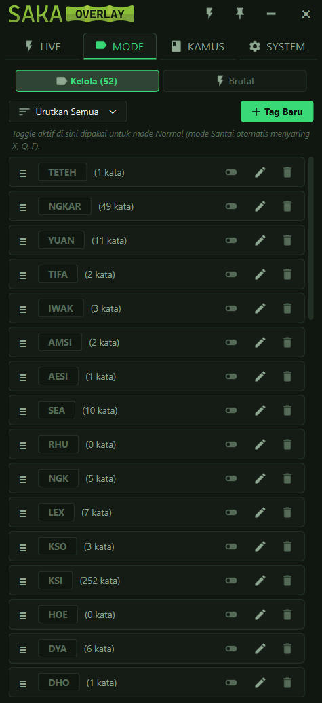
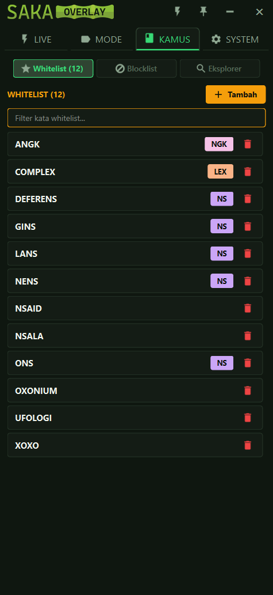

<div align="center">
    
  <br><br>
    
[](https://www.roblox.com/games/130342654546662/Sambung-Kata)
[](https://www.microsoft.com/)  
[](https://www.python.org/)
[](https://pypi.org/project/PySide6/)
[](https://opencv.org/)
</div>

SAKA Overlay is a Windows overlay assistant for the Roblox game [Sambung Kata](https://www.roblox.com/games/130342654546662/Sambung-Kata). It reads the starting letters on your screen and suggests the best words to play.

SAKA Overlay adalah aplikasi overlay untuk game Roblox Sambung Kata. Aplikasi ini membaca awalan huruf giliran Anda langsung dari layar, lalu menampilkan daftar kata yang bisa dipakai. Rekomendasi diprioritaskan pada kata yang menyulitkan lawan, dan Anda tetap mengetik sendiri di game.

## Fitur Utama

- **Deteksi otomatis:** membaca awalan huruf giliran Anda langsung dari layar.
- **Rekomendasi kata:** menampilkan daftar kata berawalan tersebut, dengan prioritas pada kata yang sulit dilanjutkan lawan.
- **Tiga mode:** Normal, Santai (menyaring kata berhuruf X, Q, dan F), serta Brutal (preset akhiran khusus).
- **Akhiran kustom:** tambah, urutkan, dan aktifkan akhiran pilihan Anda sendiri.
- **Kamus pribadi:** whitelist untuk kata yang pasti diterima, blocklist untuk kata yang ditolak game, dan eksplorer untuk mencari kata.
- **Sinkronisasi Database Real-Time (Opsional):** mendukung dua mode penyimpanan — **Lokal (File TXT)** sebagai bawaan publik, serta **Database (Self-hosted via Supabase)** untuk berbagi whitelist, blocklist, kata tambahan, dan pengaturan Tab MODE secara *real-time* bersama teman grup.

## Tampilan

<table>
  <tr>
    <td align="center"><b>LIVE:</b> awalan yang terbaca dan daftar rekomendasi kata.<br><br></td>
    <td align="center"><b>MODE:</b> mengelola akhiran dan memilih mode permainan.<br><br></td>
  </tr>
  <tr>
    <td align="center"><b>KAMUS:</b> whitelist, blocklist, dan eksplorer kata.<br><br></td>
    <td align="center"><b>SYSTEM:</b> area scanner, tampilan, dan hotkey.<br><br></td>
  </tr>
</table>

## Instalasi

Prasyarat:

- Windows 10 atau 11
- [Python](https://www.python.org/downloads/) 3.10 atau lebih baru (centang "Add Python to PATH" saat instalasi)

Langkah:

1. Unduh repositori ini (Code, lalu Download ZIP) dan ekstrak, atau clone:
    ```
    git clone https://github.com/anv-group/saka-overlay.git
    ```
2. Double click `run.bat`. Dependensi akan diinstall otomatis jika belum ada.

Alternatif lewat terminal:

```
pip install -r requirements.txt
python main.py
```

## Cara Penggunaan

1. Buka Roblox Sambung Kata, lalu jalankan SAKA Overlay.
2. Buka tab **SYSTEM**, klik **Atur Area Scanner**, lalu tarik kotak di sekitar kotak putih berisi awalan huruf.
3. Klik **Cek Area Scanner** untuk memastikan posisinya tepat.
4. Kembali ke tab **LIVE**, pilih mode (Normal, Santai, atau Brutal), lalu tekan **Mulai** atau `F1`.
5. Saat giliran Anda, lihat daftar rekomendasi kata berawalan huruf yang terbaca, lalu ketik kata pilihan Anda secara manual di game.
6. Gunakan **Whitelist** (`F3`) untuk menyimpan kata bagus yang Anda sukai dan sudah pasti bisa dipakai, misalnya kata berakhiran sulit. Kata tersebut akan muncul di urutan teratas.
7. Gunakan **Blocklist** (`F4`) untuk memblokir kata yang masih muncul di rekomendasi tetapi tidak bisa dipakai di game.

## Hotkey

Semua hotkey dapat diubah di tab **SYSTEM**.

| Aksi             | Tombol |
| :--------------- | :----: |
| Mulai / Hentikan |  `F1`  |
| Flag Kesalahan   |  `F2`  |
| Whitelist Kata   |  `F3`  |
| Blacklist Kata   |  `F4`  |
| Akhiran Baru     |  `F6`  |
| Kata Baru        |  `F7`  |

Ganti Mode kosong secara bawaan dan dapat diisi sendiri. Saat kotak input (F3, F4, F6, F7) terbuka, kursor langsung aktif, dan setelah `Enter` fokus kembali ke game.

## Sinkronisasi Database (Self-hosted via Supabase)

Jika Anda ingin bermain bersama teman dengan **Whitelist, Blocklist, Kata Tambahan, serta Tab MODE (Tag, Urutan, On/Off, Preset Brutal, Mode Permainan)** yang langsung tersinkronisasi secara *real-time*:

### 1. Pembuat Database (1x Setup)
1. Buat project gratis di [Supabase](https://supabase.com).
2. Buka SAKA Overlay → tab **SYSTEM** → bagian **DATABASE SINKRONISASI** → pilih **Database (Self-hosted)**.
3. Klik **Salin SQL**, lalu tempel dan **Run** di **Supabase Dashboard → SQL Editor → New Query**.
4. Masuk ke **Project Settings → API / API Keys** di Supabase, lalu salin **Project URL** dan **Publishable / Anon Key** ke SAKA Overlay *(jangan pernah membagikan Secret / service_role key)*.
5. *(Opsional)* Isi **Nickname** Anda, lalu klik **Tes & Hubungkan**.
6. Jika ingin menyalin daftar kata & tag lokal awal Anda ke database, klik **Upload Lokal → DB**.

### 2. Mengundang Teman
1. Klik **Salin Invite** di aplikasi Anda untuk menyalin kode `saka-db://...` ke clipboard, lalu kirimkan ke teman grup Anda secara privat.
2. Teman Anda cukup membuka tab **SYSTEM → Database (Self-hosted) → Tempel Invite** (mengambil kode otomatis dari clipboard), mengisi **Nickname**, lalu klik **Tes & Hubungkan**.
3. Setelah terhubung, perubahan dari teman maupun lokal langsung tersinkronisasi *real-time* tanpa restart, disertai indikator **User Online** dan kedipan ikon di title bar. Anda juga bisa memakai **Download DB → Lokal** kapan saja untuk menyimpan isi database ke file `.txt` lokal.

## Catatan

- Hanya untuk Windows 10 dan 11.
- Aplikasi hanya membaca layar dan menampilkan rekomendasi. Aplikasi tidak mengirim input ke game, jadi Anda tetap mengetik sendiri.
- Pengaturan pribadi (area, akhiran, mode, hotkey) disimpan lokal dan tidak hilang saat aplikasi diperbarui.
- Flag Kesalahan (`F2`) menyimpan tangkapan layar saat deteksi salah baca, untuk membantu perbaikan.
