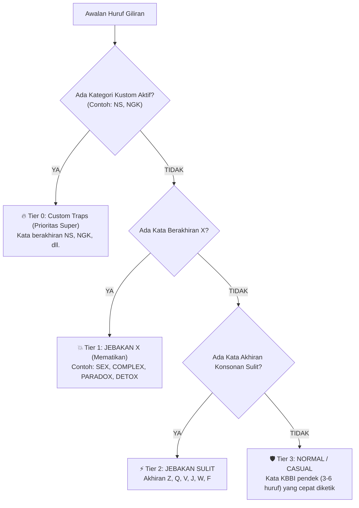

# 🎮 Roblox Sambung Kata Assistant & Auto Solver

[](https://github.com/anv-group/sambung-kata-overlay/actions/workflows/test.yml)

Asisten cerdas pendamping bermain game **Roblox Sambung Kata** ([Mainkan di Roblox](https://www.roblox.com/games/130342654546662/Sambung-Kata)).

Aplikasi ini secara otomatis mendeteksi kotak awalan huruf giliran Anda di layar secara *real-time*, memilihkan kata serangan terbaik dari kamus **147.880+ kata** (KBBI v6 + Database Contek Game Roblox), lengkap dengan petunjuk sisa huruf yang perlu Anda ketik sebelum waktu habis!

---

## ⚡ Panduan Kilat 1 Menit (Quick Start)

1. **Buka Roblox** dan masuk ke room permainan **Sambung Kata**.
2. **Jalankan Asisten:** Klik ganda file **`run.bat`** (atau jalankan `python main.py`). Window akan otomatis menempel di sisi kanan layar dalam format *ultra-compact overlay*.
3. **Tentukan Area Huruf:**
   - Klik tombol **`⚙️`** di kanan atas, lalu pilih **`🎯 Set Area Deteksi`**.
   - Layar akan meredup. Tarik kotak seleksi menggunakan mouse tepat mengelilingi kotak putih tempat huruf giliran muncul di game Roblox.
4. **Mulai Main:**
   - Klik tombol **`▶️ Mulai`** di bilah atas.
   - Saat giliran Anda tiba, rekomendasi kata langsung muncul seketika (latensi 40–80ms).
   - Klik kartu kata yang diinginkan untuk menyalinnya ke clipboard, lalu tekan **`Ctrl + V`** dan **`Enter`** di Roblox!

---

## 🚀 Cara Instalasi & Menjalankan

### 📋 Prasyarat Sistem
- **Sistem Operasi:** Windows 10 atau Windows 11 (64-bit).
- **Python:** Versi **3.10** ke atas ([Download Python](https://www.python.org/downloads/)).
  > [!IMPORTANT]
  > Saat menginstal Python di Windows, **wajib centang opsi "Add python.exe to PATH"** di layar awal installer agar perintah python dapat dikenali sistem.

---

### 📥 Langkah Instalasi & Menjalankan

1. **Clone Repositori:**
   ```powershell
   git clone https://github.com/anv-group/sambung-kata-overlay.git
   cd sambung-kata-overlay
   ```
   *(Atau klik tombol **Code** > **Download ZIP** di GitHub lalu ekstrak foldernya).*

2. **Jalankan Aplikasi:**

   **Cara 1 — Paling Praktis (1-Klik):**
   - Klik ganda file **`run.bat`**.
   - Skrip batch otomatis memeriksa environment, memasang dependensi dari `requirements.txt` bila belum ada, dan langsung meluncurkan aplikasi GUI.

   **Cara 2 — Lewat Terminal / PowerShell:**
   ```powershell
   # 1. (Opsional tapi disarankan) Virtual environment
   python -m venv venv
   .\venv\Scripts\activate

   # 2. Instal dependensi
   pip install -r requirements.txt

   # 3. Jalankan aplikasi
   python main.py
   ```

   **Cara 3 — Mode CLI (Headless / Terminal):**
   ```powershell
   python main_cli.py
   ```

---

## 🔄 Cara Memperbarui Aplikasi (Update)

### A. Jika Menggunakan Versi Sekarang (Sudah Ada Updater):
Aplikasi sudah dilengkapi modul pembaruan otomatis di latar belakang:
- **Saat Startup:** Jika ada commit baru di repositori GitHub, dialog pembaruan akan otomatis muncul (bisa diatur ke mode *Prompt*, *Auto-Update*, atau *Disabled*).
- **Pemeriksaan Manual:** Klik tombol **`⚙️`** (Settings) di kanan atas ➔ pilih **`🔄 Cek Update Git...`** ➔ klik **`🚀 Perbarui Sekarang`**.
- **Pemilihan Branch:** Anda dapat berpindah branch secara instan (misal branch stabil `main` atau branch pengembangan `dev`) langsung dari dropdown updater.

### B. Khusus Pengguna Lama yang Clone Sebelum Fitur Updater Ada:
Bagi pengguna yang meng-clone repositori ini sebelum modul updater dibuat (sehingga belum ada menu update di GUI):
1. Buka folder aplikasi di **Terminal / Command Prompt / PowerShell**.
2. Jalankan perintah berikut:
   ```powershell
   git pull
   ```
   *(Atau `git pull origin main`)*
3. Setelah perintah di atas dijalankan sekali, seluruh modul updater, konfigurasi baru, dan fitur-fitur terkini akan langsung terpasang. Untuk pembaruan berikutnya cukup gunakan tombol update di aplikasi!

---

## 🎯 Panduan Fitur & Antarmuka Aplikasi

Jendela aplikasi didesain khusus dengan konsep **Ultra-Compact Overlay** yang mengambang di atas Roblox (*Always-on-Top*) di sisi kanan monitor:

| Elemen UI / Shortcut | Fungsi & Cara Pakai |
| :--- | :--- |
| **Title Bar Dinamis** | Format: `Sambung Kata Overlay (<branch> <commit>) [<kecepatan scan>]`. Menampilkan branch git aktif, commit hash saat ini, dan kecepatan scan secara *real-time*. |
| **`▶️ Mulai` / `⏹️ Stop`** | Menjalankan atau menghentikan pemindaian OCR layar secara instan. |
| **`🔄` (Restart)** | Merestart aplikasi dalam 1-klik secara bersih untuk mereload kamus, memori, atau konfigurasi. |
| **`NORMAL` / `SANTAI`** | Tombol tag cepat untuk beralih mode. Saat mode **`SANTAI`** aktif, seluruh kata yang mengandung atau berakhiran **X, Q, dan F** otomatis disaring dan dibuang. |
| **`📊 DEFAULT` / `🏷️ URUT TAG`** | Tombol 1-klik di header utama untuk mengganti mode sortir rekomendasi Tier 0: **`DEFAULT`** (panjang 4–7 & abjad A–Z agar cepat diketik) atau **`URUT TAG`** (memprioritaskan urutan tag kustom/jebakan tersulit). |
| **`⚙️` (Settings)** | Dropdown menu untuk konfigurasi: `🎯 Set Area Deteksi`, `👁️ Test Area Deteksi`, `⭐ Buka Whitelist Kata`, `🚫 Blocklist Kata`, `🏷️ Kategori Kustom`, `📋 Log Gameplay`, `⚡ Kecepatan Scan`, dan `🔄 Cek Update Git`. |
| **`⚡ Kecepatan Scan`** | Submenu radio button 1-klik untuk memilih kecepatan: **`🔥 40ms (Ultra Instan)`**, **`⚡ 80ms (Kilat Turbo)`**, **`🚀 150ms (Cepat)`**, atau **`🐢 300ms (Santai)`**. |
| **Search Bar Real-Time** | Input manual awalan huruf. Hasil rekomendasi langsung terfilter saat Anda mengetik tanpa perlu klik tombol cari. Input ini otomatis meng-overwrite OCR. Terdapat tombol **`❌`** di ujung kanan untuk membersihkan teks seketika. |
| **`🏷️` Quick Toggle Bar** | Deretan tombol tag kategori akhiran kustom (misal: `[NS]`, `[NGK]`) tepat di atas rekomendasi kata. Klik icon `🏷️` untuk membuka jendela Kelola Tag (edit akhiran, nama, warna, dan atur urutan prioritas). |
| **`⚡ Restart` (Dev Mode)** | Tombol restart instan di header (disembunyikan secara default, dapat diaktifkan lewat `⚙️ Settings ➔ 🛠️ Mode Development` atau shortcut `Ctrl+Shift+D`). Kebal git update via `config.local.json`. |
| **Rekomendasi Kata (Scrollable)** | Menampilkan kartu kata terurut berdasarkan tier jebakan. Dilengkapi *smooth mousewheel scroll* (scroll roda mouse di mana saja di area kartu) dan *widget pooling* (render super kilat 0.5ms). |
| **`⭐` / `☆` di Kartu Kata** | Menandai kata sebagai **Whitelist** (terbukti valid). Kata langsung mendapat prioritas #1 di kategorinya tanpa mencemari kamus utama. |
| **`❌` di Kartu Kata** | Memasukkan kata yang ditolak server Roblox ke dalam `blacklist.txt` seketika (dapat dibatalkan dengan tombol `↩️ Batalkan`). |
| **`➕ Kamus`** | Menambahkan kata baru ke kamus secara permanen (klik kiri). Klik kanan tombol ini untuk membuka **📖 Eksplorasi Kamus**. |
| **`📖 Eksplorasi Kamus & Whitelist/Blocklist`** | Jendela all-in-one penjelajah seluruh basis data kamus (147,000+ kata) dengan integrasi penuh manajemen Whitelist & Blocklist. Mendukung: pencarian berdasarkan **Awalan (Prefix)**, **Akhiran (Suffix)**, dan **Mengandung (Contains)**; filter sumber (**Semua**, **KBBI Saja**, **Contek Saja**, **KBBI + Contek**); filter **Multi-Tag** (tag kustom & konsonan sulit tanpa kurung siku dengan teks berpalet warna); **sortir semua kolom** (`#`, `Kata`, `Panjang`, `Tag`, `Sumber`); **infinite scroll** autoload tanpa batas entri (+ opsi *⚡ Muat Semua*); serta tombol aksi cepat untuk toggle status Whitelist/Blocklist, menambah kata, dan membuka file teks langsung. Dapat dibuka via `⚙️ Settings` atau klik kanan `➕ Kamus`. |
| **`F2` (Screenshot Area Deteksi)** | **Global Hotkey:** Screenshot instan (< 5ms) saat ada huruf salah baca ke folder `sample/kurang_tepat/` tanpa popup yang mengganggu permainan. Review dilakukan setelah bermain lewat menu **`📝 Pendataan Koreksi Sampel`**. |
| **`F3` (Screenshot Area Gameplay)** | Mengambil snapshot visual gameplay (kotak kata & avatar pemain) dan menyimpan metadata warna RGB/HSV ke folder `deteksi-gameplay/sample_kalibrasi/`. |
| **Desain Jendela Frameless Konsisten** | Seluruh 10 dialog popup (Kamus, Whitelist, Blocklist, Tag Kustom, Koreksi, Update, dll.) menggunakan titlebar frameless bertema gelap Catppuccin yang seragam dengan UI utama, drag-to-move, resize grip, dan shortcut <kbd>Esc</kbd> untuk menutup. |

---

## 💥 Strategi Kata & Trik Menang

Aplikasi ini menggunakan sistem tier prioritas multi-level untuk memaksimalkan peluang eliminasi lawan:



1. **🔥 Tier 0: Custom Traps (Prioritas Super):**  
   Kategori kustom buatan Anda sendiri (seperti kata berakhiran `NS`: *LENS, RESPONS*, atau `NGK`: *TENGKORAK*). Dapat diaktifkan/dinonaktifkan dengan 1-klik di bar tag `🏷️`.
2. **💥 Tier 1: JEBAKAN X (Serangan Mematikan):**  
   Kata-kata sah yang berakhiran huruf **`X`** (*SEX, COMPLEX, PARADOX, DETOX, BOX, FAX, BODREX, LATEX*). Lawan berikutnya dipaksa mencari awalan X yang sangat langka di Roblox sehingga 95% lawan akan gugur kehabisan waktu.
3. **⚡ Tier 2: JEBAKAN SULIT:**  
   Jika tidak ada akhiran X, bot memilihkan kata berakhiran konsonan sulit: **`Z`**, **`Q`**, **`V`**, **`J`**, **`W`**, dan **`F`**.
4. **🛡️ Tier 3: NORMAL / BERTAHAN:**  
   Kosakata baku bahasa Indonesia yang pendek (3–6 huruf) agar sangat cepat dan aman diketik secara manual saat waktu giliran menipis.
5. **🌿 Mode Santai:**  
   Pilihan khusus saat bermain di room Roblox Mode Santai (melarang huruf X, Q, dan F). Bot secara otomatis menyaring seluruh kata yang mengandung atau berakhiran `X, Q, F`, lalu mengalihkan serangan ke `Z, V, J, W`.
   - **Auto-Filter Custom Tag:** Seluruh tag kustom yang mengandung huruf `X`, `Q`, atau `F` (contoh: akhiran `IF`, `Q`, `EX`) otomatis dinonaktifkan seketika saat mode santai aktif.
   - **Smart Recovery:** Saat beralih kembali ke Mode Normal, hanya tag yang tadinya aktif yang dihidupkan kembali. Tag yang dari awal memang sudah nonaktif akan tetap mati secara cerdas.

### 🔄 Logika Pengurutan di Dalam Tier (Panjang Kata & Abjad)
Mengapa kata dengan akhiran berbeda bisa tampil berselang-seling (contoh saat mengetik `S` muncul `SAMP [MP]`, `SANS [NS]`, `SENS [NS]`, `SIMP [MP]`, `SINGK [NGK]`)?

Di dalam setiap tier (terutama pada **Tier 0: Custom Traps**), sistem mengurutkan rekomendasi kata berdasarkan kombinasi 2 kriteria:

1. **Prioritas Panjang Kata (Cepat & Nyaman Diketik):**
   - **Panjang 4–7 huruf** (Prioritas tertinggi, panjang ideal yang paling cepat diketik sebelum waktu habis).
   - **Panjang 3 huruf** (Prioritas kedua).
   - **Panjang 8 huruf** (Prioritas ketiga).
   - **Panjang > 8 huruf** (Prioritas terendah).

2. **Urutan Abjad (A–Z) dari Kamus:**
   Jika beberapa kata memiliki **panjang huruf yang sama** (misal sama-sama 4 huruf), sistem menggunakan *stable sort* yang mempertahankan urutan abjad asli kosakata kamus:
   - `SAMP` (4 huruf, akhiran `MP`) — abjad **SA**-M
   - `SANS` (4 huruf, akhiran `NS`) — abjad **SA**-N
   - `SENS` (4 huruf, akhiran `NS`) — abjad **SE**
   - `SIMP` (4 huruf, akhiran `MP`) — abjad **SI**-M
   - `SINS` (4 huruf, akhiran `NS`) — abjad **SI**-N
   - `SOMP` (4 huruf, akhiran `MP`) — abjad **SO**
   - Kemudian beralih ke kelompok 5 huruf: `SAINS` (`NS`), `SINGK` (`NGK`), `SIUPP` (`PP`), `SPONS` (`NS`), dst.

> [!TIP]
> **Pilihan Mode Sortir Tier 0:**
> 1. **Default (Panjang & Abjad):** Memprioritaskan kata panjang 4–7 huruf (nyaman & cepat diketik), urutan abjad asli kamus dipertahankan lintas tag.
> 2. **Sesuai Urutan Tag Kustom:** Seluruh kata dari tag urutan teratas (misal tag jebakan tersulit buatan Anda) dimunculkan terlebih dahulu sebelum beralih ke tag berikutnya.
> Pengaturan ini dapat diubah langsung 1-klik via tombol **`📊 DEFAULT` / `🏷️ URUT TAG`** di header UI utama, di jendela `🏷️ Kelola Kategori Custom`, atau via menu `⚙️ Settings ➔ 📊 Mode Sortir Tier 0`.

---

## 📚 Basis Kosakata & Kamus

Aplikasi menggabungkan basis data kosakata terlengkap (**147.880+ kata unik**):
- **KBBI VI (112.822 kata):** Kosakata baku resmi Kamus Besar Bahasa Indonesia Edisi VI.
- **Contek Sambung Kata (108.130 kata):** Basis data `contek-sambungkata.web.id` yang mencakup kosakata gaul, istilah Roblox (`aho`, `alo`, `wibu`, `noob`, `pro`, `roblox`), imbuhan fleksibel, dan kata serangan.
- **⭐ Whitelist Terverifikasi (`whitelist.txt`):** Daftar kata yang terbukti berhasil dimasukkan di Roblox. Kata whitelist diposisikan di urutan paling atas di dalam kategorinya (misal: di kategori X atau kategori kustom) dan tidak perlu dimasukkan ke kamus umum (hanya hidup di `whitelist.txt`).
- **🚫 Blocklist Ditolak (`blacklist.txt`):** Daftar kata yang ditolak/disensor game Roblox sehingga tidak akan disarankan kembali oleh bot.
- **Pembersihan Kata:** Seluruh kata bahasa Inggris non-Indonesia murni yang ditolak Roblox telah disaring (contoh: bot menggunakan `klimaks`, bukan `climax`).
- **Validasi Struktur:** Setiap kata wajib memiliki minimal satu vokal untuk menyaring singkatan yang tidak valid di game.

---

## 🎮 Pemantau & Pengindeks Gameplay Otomatis

Aplikasi dilengkapi modul pemantau gameplay (`gameplay_indexer.py`) untuk mengenali respon visual nyata server Roblox:
- **`KATA_SALAH`:** Kotak input berubah menjadi latar merah pekat tanpa subtext ➔ otomatis dicatat ke file staging terisolasi `auto_blacklist.txt`.
- **`SUDAH_DIGUNAKAN`:** Kotak merah dengan subtext `"... sudah digunakan!"` ➔ terbukti valid di Roblox, otomatis dicatat ke `auto_kata_baru.txt`.
- **`KATA_BENAR`:** Kotak teks lenyap seketika dan avatar karakter memancarkan kilatan hijau (*green flash*) ➔ otomatis dicatat ke `auto_kata_baru.txt`.
- *Prinsip Human-in-the-Loop:* Kamus utama dan blacklist resmi pengguna **100% aman dan tidak tercemar**. Seluruh data deteksi otomatis tersimpan terpisah di folder staging untuk dapat diverifikasi.

---

## 🧪 Pengujian & CI Benchmark

Setiap perubahan kode diverifikasi melalui automated test suite lengkap:
```powershell
# 1. Uji Akurasi OCR Layar (92 Sampel Nyata Roblox)
python test_accuracy.py

# 2. Uji Unit Solver, Tier Prioritas & Custom Traps
python test_solver.py

# 3. Uji Deteksi Visual Sekuens Gameplay
python test_gameplay_indexer.py
```
> Seluruh pengujian di atas dijalankan otomatis oleh **GitHub Actions** pada runner Windows setiap kali terjadi push atau pull request ke branch `main`.

---

## ❓ Tanya Jawab & Kendala Umum (FAQ)

### Q: Apakah akun Roblox saya aman dari ban?
**A:** Sangat aman. Aplikasi bekerja 100% dari luar Roblox sebagai asisten overlay visual. Aplikasi hanya membaca piksel tangkapan layar dan berinteraksi melalui clipboard Windows standar. Tidak ada injeksi memori, pembacaan proses, atau manipulasi file game Roblox.

### Q: Teks awalan di game tidak terbaca atau akurasinya berkurang?
1. Buka menu **`⚙️`** ➔ klik **`👁️ Test Area Deteksi`** untuk memastikan area kotak seleksi pas mengelilingi kotak putih awalan huruf.
2. Jika posisi jendela Roblox bergeser, pilih **`🎯 Set Area Deteksi`** dan tarik ulang kotak seleksi.
3. Pastikan tidak ada jendela aplikasi lain atau avatar pemain yang menutupi kotak huruf di dalam game.

### Q: Ada huruf yang salah terbaca saat bermain?
Tekan tombol **`F2`** di keyboard! Screenshot akan tersimpan seketika (< 5ms) ke folder `sample/kurang_tepat/` tanpa memunculkan popup yang mengganggu tempo bermain. Setelah selesai bermain, klik **`📝 Koreksi`** untuk melihat gambar diperbesar dan melabeli huruf yang benar.

### Q: Aplikasi tidak mau terbuka saat klik `run.bat`?
Pastikan Anda sudah menginstal **Python** (versi 3.10+) dan mencentang opsi *"Add Python to PATH"* saat instalasi awal.
