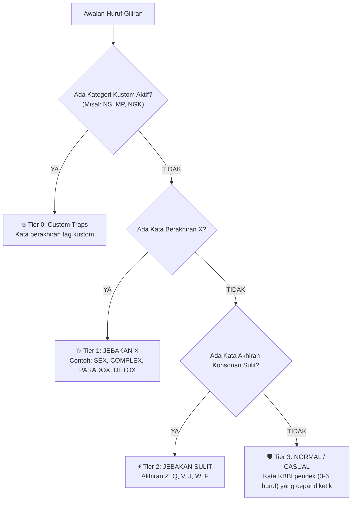

<div align="center">


# SAKA Overlay
### 🎮 Asisten Cerdas, Visi Komputer & Auto Solver Roblox Sambung Kata

[](https://www.python.org/)
[](https://pypi.org/project/PySide6/)
[](https://opencv.org/)
[](https://www.microsoft.com/)
[](LICENSE)

</div>

**SAKA Overlay** (*SAmbung KAta Overlay*) adalah aplikasi asisten *desktop overlay* modern berlatensi ultra-rendah untuk mendampingi pemain dalam game **Roblox Sambung Kata** ([Mainkan di Roblox](https://www.roblox.com/games/130342654546662/Sambung-Kata)).

Mengusung antarmuka bertema **Tactical Cyber Bamboo** (terinspirasi dari antarmuka modern *cheat client*), SAKA Overlay secara otomatis membaca kotak awalan huruf giliran Anda di layar menggunakan teknologi **Dual-Engine Computer Vision (OCR)**, lalu merekomendasikan kata serangan terbaik dari basis data raksasa **147.900+ kata** (KBBI Edisi VI + Database Contek Game Roblox). Aplikasi ini dirancang untuk menjebak lawan dengan akhiran kata mematikan (**X**, konsonan sulit, dan tag brutal) atau menyelamatkan Anda saat lawan menjebak dengan awalan langka.

---

## 📑 Daftar Isi (Table of Contents)

- [1. Fitur Utama (Features)](#-fitur-utama-features)
- [2. Panduan Instalasi (Installation Instructions)](#-panduan-instalasi-installation-instructions)
  - [Prasyarat Sistem](#-prasyarat-sistem)
  - [Langkah-Langkah Instalasi](#-langkah-langkah-instalasi)
- [3. Panduan Penggunaan & Antarmuka (Usage with Screenshots)](#-panduan-penggunaan--antarmuka-usage-with-screenshots)
  - [Panduan Kilat (Quick Start)](#-panduan-kilat-quick-start)
  - [Tab 1: ⚡ LIVE — Ruang Kendali Bermain](#-tab-1--live--ruang-kendali-bermain)
  - [Tab 2: 🏷️ TAGS — Kategori Kustom & Mode Brutal](#-tab-2-️-tags--kategori-kustom--mode-brutal)
  - [Tab 3: 📖 KAMUS — Penjelajah Kata, Whitelist & Blocklist](#-tab-3--kamus--penjelajah-kata-whitelist--blocklist)
  - [Tab 4: ⚙️ SYSTEM — Pengaturan, Scanner & Tampilan](#-tab-4-️-system--pengaturan-scanner--tampilan)
  - [Mini Ticker Bar Real-Time](#-mini-ticker-bar-real-time)
  - [Mekanisme Kalibrasi & Koreksi Sampel (F2 / Del)](#-mekanisme-kalibrasi--koreksi-sampel-f2--del)
- [4. Strategi Kata & Trik Menang](#-strategi-kata--trik-menang)
- [5. Tumpukan Teknologi (Tech Stack)](#-tumpukan-teknologi-tech-stack)
- [6. Pengujian & Jaminan Kualitas](#-pengujian--jaminan-kualitas)
- [7. Tanya Jawab Umum (FAQ)](#-tanya-jawab-umum-faq)

---

## ✨ Fitur Utama (Features)

* ⚡ **Dual-Engine Computer Vision & OCR:**
  * **Fast-Path (1–2 Huruf):** Kombinasi *Template Matching* dan analisis bentuk geometris piksel dengan latensi eksekusi hanya **1–2 ms**. Mampu membedakan glyph identik Roblox tanpa salah baca (`B` vs `D` vs `E` vs `O` vs `U`, `G` vs `C` vs `O`, `Q` vs `O`, `I`, `W` vs `U`).
  * **Deep-Path (3 Huruf & Huruf Menempel):** Pemotongan kontur cerdas (*vertical projection dip*) untuk huruf yang bersentuhan kaki/lengannya (seperti `KAR`, `AKAN`) dipadukan dengan RapidOCR DBNet ONNX berfitur multi-padding adaptif (`[8, 0, 15, 20]`).
* 💥 **Sistem Prioritas Kata Bertingkat (Tier Matrix):**
  * **Tier 0:** *Custom Traps* (kata berakhiran tag kustom seperti `NS`, `MP`, `NGK`).
  * **Tier 1:** *Jebakan X* (kata berakhiran `X` seperti `SEX`, `COMPLEX`, `PARADOX`, `DETOX`).
  * **Tier 2:** *Jebakan Sulit* (kata berakhiran konsonan `Z`, `Q`, `V`, `J`, `W`, `F`).
  * **Tier 3:** *Normal / Defensif* (kosakata baku KBBI terpendek untuk kecepatan mengetik darurat).
* 🎮 **Tiga Mode Permainan Taktis:**
  * **⚔️ DEFAULT:** Mode serangan standar dengan jebakan X, konsonan sulit, dan tag kustom aktif.
  * **🌿 SANTAI:** Dikhususkan untuk room Roblox Santai. Otomatis membuang kata yang mengandung/berakhiran `X`, `Q`, dan `F`.
  * **🔥 BRUTAL:** Mode ofensif ekstrem dengan daftar akhiran mematikan seperti `AMSI, KSO, RHU, TL, BD`.
* 🛡️ **Isolasi Whitelist & Blocklist:**
  * **Whitelist (`whitelist.txt`):** Kata valid langsung menempati posisi teratas (#1) tanpa mengubah file kamus inti.
  * **Blocklist (`blacklist.txt`):** Kata yang ditolak/disensor game langsung diabaikan secara instan ($O(1)$).
* 🎨 **Antarmuka Tactical Cyber Modern (PySide6):**
  * Tema *Tactical Cyber Bamboo* gelap obsidian (`#0b0f0c`) dengan aksen hijau neon (`#a2c73e`).
  * Custom frameless titlebar dengan resize border Windows asli via event `WM_NCHITTEST`.
  * Pin *Always-on-Top* terintegrasi dua arah dengan pengaturan sistem.
  * Baris tag dengan pembungkusan dinamis (*dynamic auto-reflow* saat resize).
  * Bersih dari emoji bawaan OS, digantikan oleh ikon vektor Material Design (MDI) beresolusi tinggi.
* 🔄 **Konfigurasi Kebal Pembaruan Git:**
  * Pengaturan lokal disimpan pada `config.local.json` (terdaftar di `.gitignore`), memastikan mode game, tag kustom, dan area deteksi Anda tidak pernah hilang saat melakukan update aplikasi via Git.

---

## 🚀 Panduan Instalasi (Installation Instructions)

### 📋 Prasyarat Sistem
- **Sistem Operasi:** Windows 10 atau Windows 11 (64-bit).
- **Python:** Versi **3.10** atau lebih baru ([Unduh Python](https://www.python.org/downloads/)).
  > [!IMPORTANT]
  > Saat menginstal Python di Windows, **wajib mencentang kotak "Add python.exe to PATH"** di halaman awal installer agar perintah dapat dipanggil dari terminal.

---

### 📥 Langkah-Langkah Instalasi

1. **Clone Repositori:**
   ```powershell
   git clone https://github.com/anv-group/sambung-kata-overlay.git
   cd sambung-kata-overlay
   ```
   *(Atau unduh file ZIP melalui tombol **Code ➔ Download ZIP** di GitHub lalu ekstrak foldernya).*

2. **(Opsional tapi Disarankan) Buat Virtual Environment:**
   ```powershell
   python -m venv venv
   .\venv\Scripts\activate
   ```

3. **Pasang Dependensi:**
   ```powershell
   pip install -r requirements.txt
   ```

4. **Jalankan Aplikasi:**
   * **Cara 1 — 1-Klik Paling Praktis (Direkomendasikan):**  
     Cukup klik ganda file **`run.bat`** di folder proyek.
   * **Cara 2 — Melalui Terminal / PowerShell:**
     ```powershell
     python main.py
     ```
   * **Cara 3 — Terminal / Headless CLI Mode:**
     ```powershell
     python main_cli.py
     ```

---

## 🖥️ Panduan Penggunaan & Antarmuka (Usage with Screenshots)

### ⚡ Panduan Kilat (Quick Start)
1. Buka game **Roblox Sambung Kata** di layar Anda.
2. Luncurkan aplikasi dengan mengklik **`run.bat`**. Window akan otomatis mengambang (*overlay*) di sisi kanan layar.
3. Buka tab **`⚙️ SYSTEM`** ➔ klik tombol **`🎯 Tentukan Area Layar`**. Tarik kotak seleksi transparan tepat mengelilingi kotak putih tempat huruf awalan muncul di game Roblox.
4. Kembali ke tab **`⚡ LIVE`** ➔ klik **`▶️ MULAI SCAN`**.
5. Saat giliran tiba, kata rekomendasi akan muncul secara instan. Klik kartu kata untuk menyalinnya ke clipboard, lalu tekan `Ctrl + V` dan `Enter` di game!

---

### ⚡ Tab 1: LIVE — Ruang Kendali Bermain

Tab **LIVE** adalah ruang kerja utama saat permainan sedang berlangsung. Didesain secara ergonomis dengan kecepatan tanggap tinggi.

<div align="center">
  
  <p><em>Tampilan Tab LIVE: Mode Switcher, Card Awalan Huruf, Tag Kustom Cepat, dan Rekomendasi Kata</em></p>
</div>

* **Mode Switcher:** Beralih instan antara mode `DEFAULT`, `SANTAI`, dan `BRUTAL`.
* **Layar Awalan (Prefix Card):** Menampilkan huruf terdeteksi dalam ukuran besar dan jelas. Kolom pencarian manual dapat digunakan kapan saja untuk menimpa hasil deteksi otomatis.
* **Bar Tag Kustom Cepat:** Deretan tombol tag akhiran yang mendukung penataan baris dinamis (*auto-reflow*) saat jendela diubah ukurannya.
* **Kartu Kata Rekomendasi:**
  * Klik kata untuk menyalin langsung ke clipboard.
  * Klik ikon bintang (`⭐` / `☆`) untuk memasukkan/mengeluarkan kata dari Whitelist.
  * Klik ikon silang (`✕`) untuk memblokir kata ke dalam Blacklist.
* **Tombol Deteksi Salah (`F2`):** Tangkapan layar kilat (< 5ms) saat terjadi salah baca OCR tanpa mengganggu jalannya permainan.

---

### 🏷️ Tab 2: TAGS — Kategori Kustom & Mode Brutal

Tab **TAGS** memberikan kendali penuh terhadap manajemen akhiran kata mematikan yang ingin Anda prioritaskan.

<div align="center">
  
  <p><em>Tampilan Tab TAGS: Manajemen Tag Kustom, Indikator Aktif, dan Pengaturan Mode Brutal</em></p>
</div>

* **Kelola Akhiran Kata:** Tambah, ubah nama, pilih warna badge, atau hapus tag kustom Anda.
* **Mode Urutan Tag (Tag Order):** Mengatur prioritas kata agar mengalir ketat berdasarkan urutan tag dari atas ke bawah.
* **Pengaturan Tag Mode Brutal:** Pilih tag mana saja yang otomatis menyala saat Mode Brutal diaktifkan via interaksi se-baris (*click anywhere*) dengan kontras visual tinggi.

---

### 📖 Tab 3: KAMUS — Penjelajah Kata, Whitelist & Blocklist

Pusat eksplorasi seluruh kosakata **147.900+ kata** yang dilengkapi manajemen Whitelist dan Blocklist terintegrasi.

<div align="center">
  
  <p><em>Tampilan Tab KAMUS: Eksplorasi Kosakata, Multi-Filter, dan Manajemen Status Kata</em></p>
</div>

* **3 Mode Pencarian:** Cari berdasarkan **Awalan (Prefix)**, **Akhiran (Suffix)**, atau **Mengandung (Contains)**.
* **Filter Sumber Kosakata:** Saring kata berdasarkan `Semua`, `KBBI Saja`, `Contek Saja`, atau `KBBI + Contek`.
* **Manajemen Instan:** Tambah kata baru ke kamus secara permanen, atau ubah status Whitelist dan Blocklist secara langsung.

---

### ⚙️ Tab 4: SYSTEM — Pengaturan, Scanner & Tampilan

Pusat pengaturan operasional sistem, kalibrasi scanner, dan manajemen pembaruan git.

<div align="center">
  
  <p><em>Tampilan Tab SYSTEM: Konfigurasi Scanner, Tampilan, Sampel, dan Informasi Versi</em></p>
</div>

* **SCANNER:** Kalibrasi area ROI layar (`🎯 Tentukan Area Layar`, `👁️ Uji Area Layar`) dan atur kecepatan pemindaian (40ms, 80ms, 150ms, 300ms).
* **TAMPILAN:** Pengaturan *Selalu di Atas (Always-on-Top)* yang tersinkronisasi dengan tombol Pin di titlebar.
* **SAMPEL:** Akses folder sampel dan buka jendela koreksi hasil tangkapan F2.
* **VERSI:** Pemantau branch git aktif, nomor commit hash saat ini, dan tombol pembaruan aplikasi.

---

### 🔴 Mini Ticker Bar Real-Time

Ketika Anda berpindah ke tab lain (seperti tab `TAGS`, `KAMUS`, atau `SYSTEM`), sebuah **Mini Ticker Bar** ramping akan otomatis muncul di bawah tab navigasi jika pemindaian sedang aktif.

<div align="center">
  
  <p><em>Mini Ticker Bar: Menampilkan status deteksi OCR dan rekomendasi kata saat membuka tab lain</em></p>
</div>

* Menampilkan status `[LIVE]` atau `[MANUAL]` beserta awalan kata yang sedang aktif.
* Menampilkan kata rekomendasi teratas dan kategori tag terkait sehingga Anda tidak akan ketinggalan giliran bermain.

---

### 📝 Mekanisme Kalibrasi & Koreksi Sampel (F2 / Del)

Jika OCR mendeteksi huruf yang salah saat bermain, tekan tombol **`F2`** di keyboard. Tangkapan layar akan disimpan seketika (< 5 ms) ke folder `sample/kurang_tepat/`. Setelah permainan selesai, Anda dapat membuka jendela **Koreksi Sampel**:

<div align="center">
  
  <p><em>Jendela Koreksi Visual: Navigasi keyboard penuh (Enter untuk simpan, Del untuk hapus)</em></p>
</div>

* Gambar ditampilkan dalam ukuran besar untuk memudahkan inspeksi visual.
* Cukup ketik huruf yang benar lalu tekan <kbd>Enter</kbd> untuk berpindah ke sampel berikutnya secara otomatis.
* Tekan tombol <kbd>Del</kbd> di keyboard untuk langsung menghapus sampel sampah tanpa dialog konfirmasi tambahan.

---

## 💥 Strategi Kata & Trik Menang

Aplikasi ini menggunakan alur logika terstruktur untuk memaksimalkan peluang eliminasi lawan di setiap giliran:



1. **Prioritas Panjang Kata Ideal (4–7 Huruf):** Di dalam setiap tier, kata dengan panjang 4–7 huruf dimunculkan terlebih dahulu karena terbukti paling cepat dan nyaman diketik sebelum timer giliran habis.
2. **Sortir Abjad Alami (A–Z):** Kata dengan panjang yang sama diurutkan secara alfabetis berdasarkan kamus asli (*stable sort*).

---

## 🛠️ Tumpukan Teknologi (Tech Stack)

| Lapisan / Komponen | Teknologi & Library | Deskripsi Peran |
| :--- | :--- | :--- |
| **GUI Framework** | **PySide6 (Qt 6.5+)** | Antarmuka desktop modern, akselerasi perangkat keras, rendering lancar 60 FPS |
| **Computer Vision** | **OpenCV (`cv2`)** | Grayscale thresholding, analisis kontur, dan pemotongan vertikal komponen terhubung |
| **OCR Engines** | **Template Matching + RapidOCR ONNX** | Arsitektur *Dual-Engine*: Template Matching untuk 1–2 huruf (1–2 ms) & RapidOCR DBNet untuk 3 huruf |
| **Screen Capture** | **MSS** | Tangkapan layar berkecepatan tinggi dengan latensi di bawah 10 ms |
| **Image Processing** | **Pillow (PIL)** | Pewarnaan dinamis ikon vektor MDI melalui masking alfa (*C-level memory cache*) |
| **Data Engine** | **Python Trie & Hash Set** | Pencarian prefix dan penyaringan blacklist/whitelist instan dalam kompleksitas $O(1)$ |
| **Native Windows API** | **`ctypes` / Win32 API** | Penskalaan DPI presisi monitor 1920x1200 dan implementasi resizer border `WM_NCHITTEST` |

---

## 🧪 Pengujian & Jaminan Kualitas

Setiap pembaruan kode diverifikasi menggunakan rangkaian *automated regression test suite*:

```powershell
# 1. Uji Akurasi OCR (Benchmark 92 Sampel Nyata Roblox)
python test_accuracy.py

# 2. Uji Unit Solver, Tier Prioritas, Whitelist & Blacklist
python test_solver.py

# 3. Uji Pengindeks Respon Visual Sekuens Gameplay
python test_gameplay_indexer.py
```

> **Standar Kelulusan CI:** Wajib **100% Pass** pada 92 sampel OCR Roblox dan seluruh pengujian unit solver harus berstatus **OK**.

---

## ❓ Tanya Jawab Umum (FAQ)

### Q: Apakah akun Roblox saya aman dari sanksi / ban?
**A:** **100% Aman.** SAKA Overlay beroperasi sepenuhnya di luar Roblox sebagai *overlay visual*. Aplikasi ini hanya membaca piksel layar dan berkomunikasi via clipboard Windows standar tanpa melakukan injeksi memori, pembacaan proses Roblox, atau modifikasi file game apa pun.

### Q: Huruf awalan di game tidak terbaca oleh aplikasi?
1. Buka tab **`⚙️ SYSTEM`** ➔ klik **`👁️ Uji Area Layar`** untuk memeriksa apakah kotak seleksi pas mengelilingi kotak putih game.
2. Jika posisi jendela Roblox berpindah, gunakan tombol **`🎯 Tentukan Area Layar`** untuk mengatur ulang area tangkapan.
3. Pastikan tidak ada jendela aplikasi lain atau karakter Roblox yang menutupi kotak huruf giliran.

### Q: Bagaimana cara memperbarui aplikasi ke versi terbaru?
Buka tab **`⚙️ SYSTEM`** ➔ lihat bagian **VERSI** ➔ klik **`🚀 Perbarui Sekarang`**. Modul updater bawaan akan menyinkronkan repositori Anda dengan commit terbaru secara otomatis.

---

<div align="center">
  <p>Dibuat dengan ❤️ untuk komunitas Roblox Sambung Kata Indonesia.</p>
</div>
